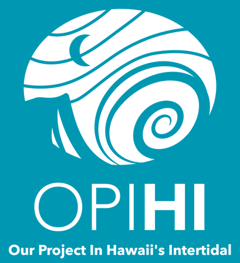

# AI Data Sprint - Group A
## Wei Shen Li, Fabi Zamora, Natalie Goeler-Slough, Ellie S Jones

### Quarto links
Group A Quarto PLACEHOLDER FOR LINK  

This Quarto document combines all group work from data cleaning, documentation, and R workflow, as well as code for functions and figures.  

### AI Usage
_AI Developer Logs are located in a separate ReadMe at this link_ PLACEHOLDER FOR LINK 

### Data Background
We are working with the OPIHI (Our Project in Hawai'i's Intertidal) data to clean and create plots to better understand intertidal community composition in Hawai'i.  

### Research Question
Our group investigated change over time in the data from 2004-2026. (_2009-2015 and 2021-2023 are not included in these analyses due to a lack of data, as explained in the AI Developer Logs._) We decided to answer the following questions through our data cleaning and analyses:  

* How does percent cover of each functional group change over time from 2004 to 2026?  
* How does species richness of limu (macroalgae) change over time from 2004 to 2026, excluding turf algae?
