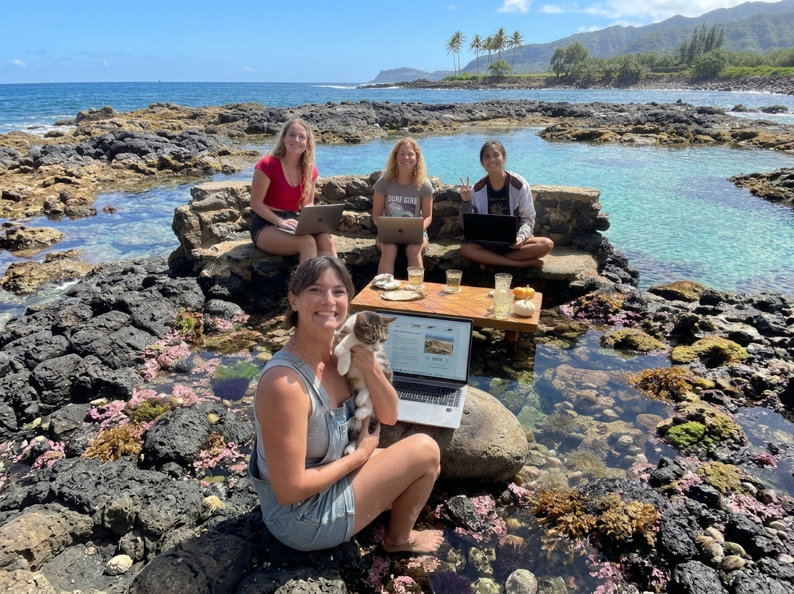

# AI Data Sprint - Group A
## Wei Shen Lim, Fabi Zamora, Natalie Goeler-Slough, Ellie S Jones

### Quarto links
[Group A Quarto](https://01a1c325-cf7d-b71d-3b3e-4bd25eedcd63.share.connect.posit.cloud/)  

This Quarto document combines all group work from data cleaning, documentation, and R workflow, as well as code for functions and figures.  

### AI Usage
This project required our group to utilize AI to clean and vizualize data from a community-collected dataset, utilizing best practices for transparent and reproducible research as well as the FAIR and CARE principles.  

[_AI Developer Logs are located in a separate ReadMe at this link_](https://github.com/OCN-682-UH/GroupA_AI_Data_Sprint/tree/main/AI_Logs#readme) 

### Data Background
We are working with the OPIHI (Our Project in Hawai'i's Intertidal) data to clean and create plots to better understand intertidal community composition in Hawai'i.  

### Research Questions
Our group investigated change over time in the data from 2004-2026. (_2009-2015 and 2021-2023 are not included in these analyses due to a lack of data, as explained in the AI Developer Logs._) We decided to answer the following questions through our data cleaning and analyses:  

* How does percent cover of each functional group change over time from 2004 to 2026?  
* How does species richness of limu (macroalgae) change over time from 2004 to 2026, excluding turf algae?

### Main Findings and Takeaways
_Padina_ spp. seemed to be the most abundant limu found in the transects, while _Echinometra mathei_ was the most abundant invertebrate. Corals found were often not identified to species.  
  
Maui had the greatest shifts in community composition over time, while Hawaiʻi and Lānaʻi remained more unchanged.  
  
Oʻahu originally had one of the higher taxonomic richness in the early years of data collection, but fell significantly nearing 2020 before rocketing back up when data began collection again in 2024. This agrees with other studies around Oʻahu that found an increase in intertidal species following the COVID-19 years, likely due to a lower amount of tourism, but this relationship between the two datasets is only speculative for now.  
  
Futher analysis would be necessary to draw stronger conclusions about the data and calculate p-values for significance. 